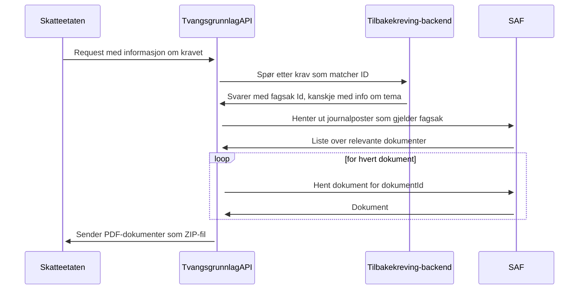

# tilbakekreving-tvangsgrunnlag

API for å dele tvangsgrunnlag mellom NAV og Skatteetaten.

## Endepunkt

`POST /api/tilbakekreving/tvangsgrunnlag/v1`

Tar imot en `TvangsgrunnlagRequest` (skyldner, oppdragsgiversKravidentifikator,
skatteetatensKravidentifikator, valgfri fraOgMedDato) og returnerer en zip-fil med
tilbakekrevingsvedtak/endringsvedtak som PDF.

Sporing skjer via `traceparent` (W3C Trace Context), håndtert automatisk av
OpenTelemetry-instrumentering (`KtorServerTelemetry`) - headeren er valgfri.
Uten en OTel-collector konfigurert (`OTEL_EXPORTER_OTLP_ENDPOINT`) eksporteres
ingen spans, men tjenesten fungerer likevel som normalt.

| Status | Betydning |
| --- | --- |
| 200 | Zip-fil med dokumenter |
| 400 | Ugyldig forespørsel |
| 404 | Tvangsgrunnlag ikke funnet |

Flyten i `TvangsgrunnlagService`:

1. Validerer request
2. Verifiserer krav i tilbakeløsningen (eller sokos-ske-krav for skatteetatensKravidentifikator)
3. Henter dokumenter, filtrert på `fraOgMedDato`
4. Zipper PDF-ene
5. Registrerer utlevering i Joark
6. Logger statistikk over utleverte vedtak

Statistikk (antall utleveringer per dokument) eksponeres som Prometheus-metrikk
(`tvangsgrunnlag_utlevering_total`) på `GET /metrics`, i tillegg til strukturerte
loggmeldinger til Loki.

## Struktur

```
modell/    Request-, dokument- og feilklasser
klient/    Interfaces mot tilbakeløsningen, sokos-ske-krav, SAF og Joark
tjeneste/  TvangsgrunnlagService og statistikk
```

`klient`-implementasjonene (`Midlertidig*Client`) er placeholders uten ekte
integrasjon. Se `TODO`-kommentarer i hver fil for hva som gjenstår.

POST-endepunktet krever et Maskinporten-token med scopet
`nav:tilbakekreving/tvangsgrunnlag.read`. Appen validerer tokenet mot issueren i
`MASKINPORTEN_WELL_KNOWN_URL`.

**Ikke implementert ennå:** audit-logging av henvendelse/utlevert dokument.
Merket med `TODO` i koden.

## Kjøre og teste

```bash
MASKINPORTEN_WELL_KNOWN_URL=https://test.maskinporten.no/.well-known/oauth-authorization-server 
./gradlew run    # Starter appen på port 8080
./gradlew test   # Kjører tester
```

I IntelliJ kan du i stedet sette `MASKINPORTEN_WELL_KNOWN_URL` under
**Run > Edit Configurations > Environment variables**. Nais setter variabelen
selv i dev.

Lokalt returnerer appen testdokumenter fra `Midlertidig*Client`, ikke ekte tvangsgrunnlag.

Swagger UI lokalt: http://localhost:8080/swagger

Swagger UI i dev-gcp: https://tilbakekreving-tvangsgrunnlag.intern.dev.nav.no/swagger

## Teste med Postman

En ferdig Postman-request ligger i [`tvangsgrunnlag.postman_collection.json`](tvangsgrunnlag.postman_collection.json),
med korrekte headere og et kjent testkrav.

1. Start appen lokalt (se over), eller sett `baseUrl` til
   `https://tilbakekreving-tvangsgrunnlag.ekstern.dev.nav.no` for dev
2. Åpne Postman, klikk **Import** øverst til venstre
3. Velg **File** og pek på `tvangsgrunnlag.postman_collection.json` i repoet
4. Klikk **Import**: collectionen `tilbakekreving-tvangsgrunnlag` dukker opp i sidepanelet
5. Hent et token (se under)
6. Åpne requesten "Hent tvangsgrunnlag (kjent krav)"
7. Trykk på pilen ved siden av **Send**-knappen og velg **Send and Download**
8. Velg hvor zip-fila skal lagres

Forventet resultat: status **200 OK** og en nedlastet zip med `dok-1.pdf` og `dok-2.pdf`.

### Hente Maskinporten-token via Texas

```bash
kubectl --context dev-gcp -n tilbake get pods -l app=tilbakekreving-tvangsgrunnlag
kubectl --context dev-gcp -n tilbake port-forward --address 127.0.0.1 pod/<podnavn> 7160:<texas-port>
```

`<texas-port>` og stien står i `NAIS_TOKEN_ENDPOINT` i Nais Console. Sett
`texasTokenUrl` i Postman til `http://127.0.0.1:7160` pluss stien. Kjør deretter
requesten "Hent Maskinporten-token via Texas". Tokenet lagres i
`maskinportenToken` og brukes av neste kall.

Tokenet representerer Nav, ikke Skatteetaten. Ikke del eller eksporter
collectionen med tokenverdien. Fjern verdien etter testing og stopp
port-forward med `Ctrl+C`.

## Arkitektur
